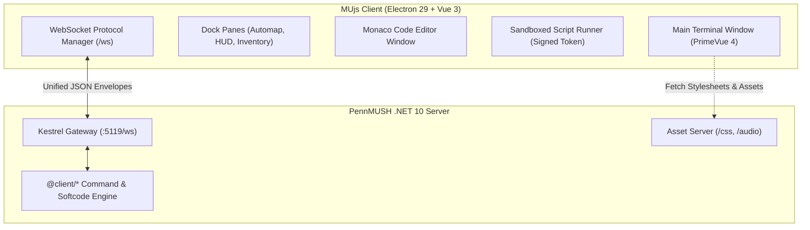
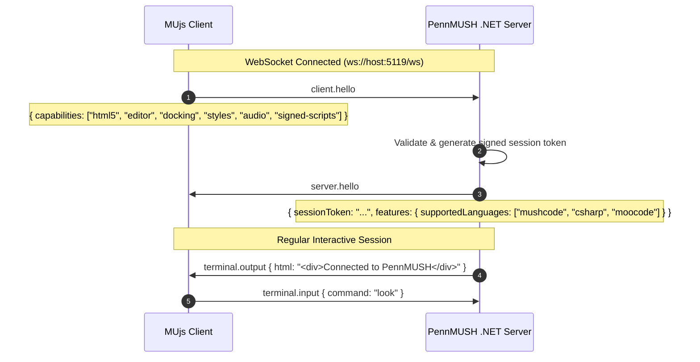

# MUjs

A modern, high-performance HTML5 desktop client for **MUSH**, **MOO**, and **MUD** virtual worlds, built with **Electron**, **Vue 3**, **PrimeVue**, and **Monaco Editor**.

MUjs is designed as the official companion client for [pennmush-dotnet](https://github.com/naHrej/pennmush-dotnet), implementing a clean, structured JSON-over-WebSocket protocol with dockable UI panels, atomic code editing RPC, and rich HTML5/CSS3 presentation—while retaining full backward compatibility for traditional text-based MUSH and MOO servers.

---

## 🌟 Key Features

- **Dual-Protocol Engine:**
  - **Modern v1.0 JSON Protocol:** Multiplexed typed envelopes over WebSockets (`client.hello`, `editor.open`, `window.update`, `style.load`, `audio.play`).
  - **Legacy Fallback:** Transparent support for traditional MOO/MUSH text scraping (`ProgStart >`, `!@Window:`, `!@style:url:`).
- **Full HTML5 & Unicode Presentation:**
  - Rich HTML rendering with seamless fallback to 24-bit TrueColor, 256-color, and 16-color ANSI.
  - Complete international Unicode support with emojis and symbols.
- **Integrated Monaco Code Editor:**
  - Embedded desktop code editor powered by Monaco (VS Code engine).
  - Multi-language syntax highlighting: **MUSHcode**, **MOOcode**, and **C#**.
  - Informational read-only header pane (dbrefs, flags, owner, timestamps).
  - Clean keyboard shortcuts: `Ctrl+S` to save, `Ctrl+Shift+S` to execute selection.
  - Load/save files directly to local disk.
- **Dockable Multi-Pane Workspace:**
  - Dynamically spawn, dock (left/right sidebars), or pop out floating windows for automaps, inventory, character HUDs, and channel chat.
  - Server-driven content actions: `append`, `prepend`, `replace`, `clear`, and `style`.
- **Dynamic Styling & Sound:**
  - Dynamically load and hot-reload remote LESS and CSS stylesheets streamed from the server.
  - Ambient audio and sound effect triggers.
- **Cryptographic Script Sandboxing:**
  - Secure sandboxed iframe / Web Worker execution gated by server-signed session tokens.

---

## 🏛️ Architecture & Tech Stack



| Layer | Technology |
| :--- | :--- |
| **Desktop Shell** | [Electron 29](https://www.electronjs.org/) |
| **Frontend Framework** | [Vue 3](https://vuejs.org/) (Composition API) + [TypeScript 5](https://www.typescriptlang.org/) |
| **UI Components** | [PrimeVue 4](https://primevue.org/) + PrimeFlex |
| **Code Editor** | [Monaco Editor](https://microsoft.github.io/monaco-editor/) + TextMate syntax grammars |
| **Build Tooling** | [electron-vite 5](https://electron-vite.org/) + Vite 5 |

---

## 📡 Client-Server Communication Protocol (v1.0)

MUjs and [pennmush-dotnet](https://github.com/naHrej/pennmush-dotnet) communicate over a unified WebSocket connection (`ws://<host>:5119/ws` or `/game`) using typed UTF-8 JSON message frames.

### 1. Universal Message Envelope

```typescript
interface ProtocolEnvelope<T = any> {
  type: string;          // e.g. "terminal.output", "editor.open", "window.update"
  id?: string;            // Correlation ID for RPC request/response
  timestamp?: number;     // Epoch millisecond timestamp
  payload: T;             // Type-specific payload
}
```

### 2. Envelope Specification

| Type | Origin | Purpose |
| :--- | :--- | :--- |
| `client.hello` | Client $\to$ Server | Handshake declaring client name, version, and supported capabilities. |
| `server.hello` | Server $\to$ Client | Server confirmation, session token, asset base URL, and supported features. |
| `terminal.input` | Client $\to$ Server | User command entered into the input prompt. |
| `terminal.output` | Server $\to$ Client | Formatted terminal output (HTML stream or ANSI text). |
| `editor.open` | Server $\to$ Client | Requests MUjs to open the Monaco editor with code and metadata. |
| `editor.save` | Client $\to$ Server | Transmits user-edited code back to the server upon save. |
| `editor.result` | Server $\to$ Client | Save confirmation with compiler or syntax diagnostics. |
| `window.update` | Server $\to$ Client | Spawns, updates, docks, or closes a UI pane or popup window. |
| `style.load` | Server $\to$ Client | Injects or updates a remote CSS/LESS stylesheet URL. |
| `audio.play` | Server $\to$ Client | Triggers a sound effect or ambient music track. |
| `script.exec` | Server $\to$ Client | Loads and runs a server-signed script in the sandbox. |

---

### 3. Capability Negotiation Handshake

Upon establishing the WebSocket connection, MUjs automatically negotiates capabilities:



---

### 4. Atomic Code Editor RPC

Replaces fragile string markers (`ProgStart >` / `ProgEdit >`) with structured RPC:

#### Step 1: Server Requests Editor (`editor.open`)
```json
{
  "type": "editor.open",
  "id": "edit-req-101",
  "payload": {
    "sessionId": "sess-84920",
    "target": {
      "dbref": "#42",
      "name": "Combat Droid",
      "member": "DO_FIRE",
      "memberType": "attribute"
    },
    "language": "mushcode",
    "title": "Editing #42/DO_FIRE",
    "headers": [
      "Object: Combat Droid (#42)",
      "Owner: Wizard (#1)",
      "Flags: WIZARD SAFE"
    ],
    "code": "$+fire *:@pemit %#=You fire at %0!;@trigger me/TRIGGER_FX",
    "readOnly": false
  }
}
```

#### Step 2: Client Saves Code (`editor.save`)
Triggered via `Ctrl+S` or the editor's Save button:
```json
{
  "type": "editor.save",
  "id": "edit-req-102",
  "payload": {
    "sessionId": "sess-84920",
    "code": "$+fire *:@pemit %#=You fire at %0!;@remit loc(%#)=%N fires!;@trigger me/TRIGGER_FX"
  }
}
```

#### Step 3: Server Confirms or Reports Diagnostics (`editor.result`)
```json
{
  "type": "editor.result",
  "id": "edit-req-102",
  "payload": {
    "sessionId": "sess-84920",
    "success": true,
    "diagnostics": []
  }
}
```

---

### 5. Multi-Pane Docking & Window Management

Servers can dynamically manage dockable sidebar panes and floating popups via `window.update`:

```json
{
  "type": "window.update",
  "payload": {
    "windowId": "automap",
    "title": "Area Automap",
    "dock": "right",
    "action": "replace",
    "content": "<div class=\"map-grid\">...</div>",
    "width": 320
  }
}
```

- **`dock` options:** `"left"`, `"right"`, `"float"` (detached window), `"none"`.
- **`action` options:** `"replace"`, `"append"`, `"prepend"`, `"clear"`, `"close"`.

---

## 🕰️ Legacy Compatibility Layer

When connected to legacy MOO or MUSH servers that do not support the v1.0 JSON protocol, MUjs transparently activates its legacy string-parsing engine:

| Legacy String Convention | Client Behavior |
| :--- | :--- |
| `ProgStart > <cmd>` | Starts code editor capture; stores `<cmd>` as save command. |
| `ProgData > <info>` | Appends to read-only header area above editor. |
| `ProgEdit > <line>` | Appends line to editable code buffer. |
| `ProgEnd > <marker>` | Concludes capture and opens editor popup. |
| `!@style:url:<url>` | Fetches and applies the remote LESS/CSS stylesheet. |
| `!@Window:<title>:<cmd>:<data>` | Dispatches content to a secondary window. |
| `@clientkey <token>` | Negotiates session key for `<script key="token">` execution. |

---

## 🛠️ Development & Building

### Prerequisites

- **Node.js:** `>= 22.12.0` (LTS `v22.14.0` recommended)
- **NPM:** `10.x` or higher

```bash
# Verify Node version
node -v   # v22.14.0
npm -v    # 10.9.2
```

### Installation

```bash
git clone https://github.com/naHrej/MUjs.git
cd MUjs
npm install
```

### Development Mode

Launches the Electron application with hot-module reloading (HMR):

```bash
npm run dev
```

### Production Build

Type-checks and compiles main, preload, and renderer bundles via `electron-vite`:

```bash
npm run build
```

### Packaging Desktop Installers

Package standalone desktop distributables via `electron-builder`:

```bash
npm run package:win     # Windows installer / portable
npm run package:linux   # Linux AppImage / deb
npm run package:all     # All target platforms
```

---

## 📜 License

Created by **Dean Santos** ([dean@santos.ws](mailto:dean@santos.ws)).  
Released under the **MIT License**.
